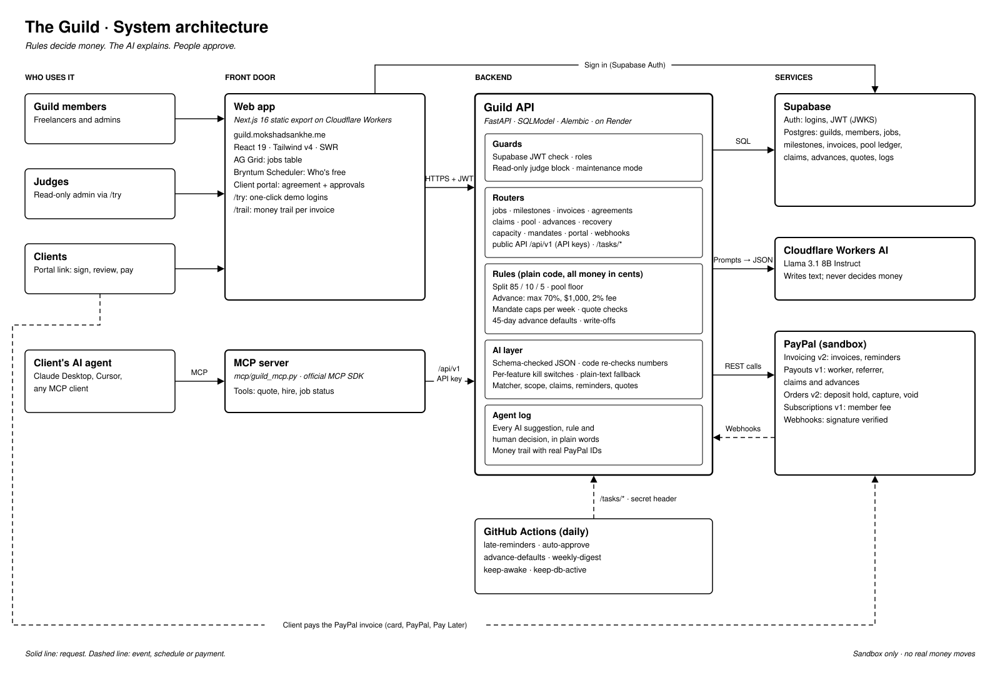

# The Guild

**Freelancers, acting like a company.** A small guild shares overflow work, splits every payment fairly through PayPal, pays members early, and keeps a shared safety pool for when a client never pays. AI agents can even hire the guild.

**Try it now:** [guild.mokshadsankhe.me/try](https://guild.mokshadsankhe.me/try/) · one click, no sign-up, PayPal sandbox money.

Built for the PayPal AI Hackathon 2026.

---

## The problem

Freelancers carry every risk alone. A client pays 30 days late, or never. A friend brings you work and gets nothing for it. You wait weeks for money you already earned. Agencies solve this with a company around the work. Solo freelancers don't have one.

## What The Guild does

A guild is a few freelancers who act like one company:

- **Share work.** Post a job you can't take. The AI picks the best member and explains why.
- **Split every payment.** The client pays a PayPal invoice. The worker, the member who found the client, and the safety pool are paid out automatically (85 / 10 / 5 by default).
- **Get paid on day one.** Once the client approves the work, the pool can advance part of your share right away. It takes it back, plus a 2% fee, when the client pays.
- **Covered when a client ghosts.** File a claim. The AI checks it for red flags, an admin decides, and the pool pays. The guild keeps chasing the client and refills the pool first when they pay.
- **Hire the guild by agent.** A client's AI (Claude Desktop, Cursor, any MCP client) gets a quote and hires the guild through an API key. The client gets a portal link to sign and pay.
- **A real agreement.** The client accepts a work agreement in their portal. The exact text is stored with a SHA-256 fingerprint. Silence for 5 business days after delivery counts as approval.
- **Every dollar traceable.** The money trail shows each invoice's journey with real PayPal IDs.

## How it uses PayPal

| PayPal API | What The Guild does with it |
|---|---|
| **Invoicing v2** | Sends a PayPal invoice per milestone, sends AI-written reminders, records "paid directly" payments |
| **Payouts v1** | Pays the worker, the referrer, claims and advances in batches |
| **Orders v2** (authorize, capture, void) | Deposit holds: the client's money is held, then captured after delivery or released |
| **Subscriptions v1** | The monthly member fee that grows the safety pool |
| **Webhooks** (verified with `verify-webhook-signature`) | `INVOICING.INVOICE.PAID`, `PAYMENT.PAYOUTSBATCH.*`, `CHECKOUT.ORDER.APPROVED`, `PAYMENT.AUTHORIZATION.VOIDED`, `BILLING.SUBSCRIPTION.*`, `PAYMENT.SALE.COMPLETED` |

Pay Later works through the PayPal invoice page, so clients can spread a payment while the guild is paid in full.

## How the AI is kept safe

**The AI suggests. Rules decide. People approve.**

- The AI (Cloudflare Workers AI) writes things: match reasons, scope drafts, claim reviews, reminders, quotes, notes for admins.
- Money is never decided by the AI. Splits, caps, advance limits and pool rules are plain code with fixed numbers.
- Code checks the AI. For example, an agreement summary is thrown away unless it repeats the exact total, and an AI quote's budget only counts if the client actually wrote it.
- The **agent mandate** lets an admin allow small things without a click (friendly reminders, small claims, small advances). Every automatic payment is logged with the admin who set the rule, and capped per week.
- Platform kill switches turn off any AI feature, or all of them, instantly.
- Every decision is in the Activity log in plain words.

## Try it

| Account | What you can do |
|---|---|
| **Judge** (admin view, read-only) | See everything an admin sees: claims, the pool, the agent log, the money trail. Nothing you click changes anything. |
| **Sara** (member) | Deliver work, ask to be paid early, file a claim. |
| **Leo** (member) | Get matched to jobs, set when you're busy. |

All three are one click on [/try](https://guild.mokshadsankhe.me/try/). Worth a look:

1. **Jobs → Gary Ghost → Money trail.** A real PayPal invoice ID, three AI-written reminders, the claim, and the Payouts batch that covered it.
2. **Safety pool.** What the pool covered, what came back, and who was paid early.
3. **Activity.** Every AI suggestion, rule and human decision.
4. **Overview → Who's free.** Member capacity on a Bryntum Scheduler, estimated from open work.

The backend runs on Render's free tier. If the first page is slow, it's waking up. Give it a minute.

## Architecture



- **Frontend:** Next.js 16, React 19, Tailwind CSS v4, SWR, AG Grid Community (jobs table), Bryntum Scheduler (capacity board)
- **Backend:** FastAPI, SQLModel, Alembic, httpx. All money is integer cents.
- **Database and auth:** Supabase
- **AI:** Cloudflare Workers AI (Llama 3.1 8B Instruct), every prompt in `backend/app/prompts.py`
- **Agents:** an MCP server in `mcp/` built with the official MCP Python SDK

## Run it locally

You need Python 3.11+, Node 20+, a Supabase project, a PayPal sandbox app, and a Cloudflare account with Workers AI.

### 1. Backend

```bash
cd backend
python -m venv .venv
# Windows: .venv\Scripts\activate    macOS/Linux: source .venv/bin/activate
pip install -r requirements.txt
cp .env.example .env        # then fill it in
alembic upgrade head
uvicorn app.main:app --reload
```

Check it at http://127.0.0.1:8000/health/db.

Seed the demo guild (Maya, Leo, Sara, and optionally Judge). First create those logins in Supabase → Authentication → Users, then:

```bash
python -m scripts.reset_demo
```

It asks you to type `RESET`, because it deletes all guild data (logins stay).

### 2. Frontend

```bash
cd frontend
npm install
cp .env.example .env.local   # then fill it in
npm run dev
```

Open http://localhost:3000.

`npm run build` uses `next build --webpack`. Bryntum's bundle is very large, and Turbopack runs out of memory on it.

### 3. MCP server (optional, to hire the guild from Claude Desktop or Cursor)

See [mcp/README.md](mcp/README.md). In short: make an API key on the Activity page as an admin, then point your MCP client at `mcp/guild_mcp.py`.

### 4. Daily jobs

The workflows in `.github/workflows` call the backend each day with an `X-Task-Secret` header. Add `TASK_SECRET` to your repository secrets and change the backend URL in each file.

| Workflow | Route | What it does |
|---|---|---|
| Late invoice reminders | `/tasks/late-invoices` | Sends due reminders, up to the tier the guild's mandate allows |
| Auto-approve | `/tasks/auto-approve` | 5 business days of silence after delivery counts as approval |
| Advance defaults | `/tasks/advance-defaults` | Advances unpaid after 45 days become a member debt |
| Keep awake / keep DB active | | Stops the free tiers from sleeping |

## Environment variables

**backend/.env** (see `backend/.env.example`)

| Name | What it is |
|---|---|
| `PAYPAL_CLIENT_ID`, `PAYPAL_CLIENT_SECRET` | Sandbox REST app credentials |
| `PAYPAL_WEBHOOK_ID` | The webhook ID from your PayPal app, for signature checks |
| `PAYPAL_BASE_URL` | `https://api-m.sandbox.paypal.com` |
| `CLOUDFLARE_ACCOUNT_ID`, `CLOUDFLARE_API_TOKEN` | Workers AI |
| `CLOUDFLARE_AI_MODEL` | Default `@cf/meta/llama-3.1-8b-instruct` |
| `SUPABASE_URL`, `SUPABASE_SECRET_KEY`, `SUPABASE_JWKS_URL` | Supabase project and token checks |
| `DATABASE_URL` | Postgres connection string |
| `FRONTEND_URL` | Used for client portal links and CORS |
| `PUBLIC_BASE_URL` | This backend's public URL |
| `TASK_SECRET` | Shared secret for the daily task routes |
| `PLATFORM_ADMINS` | Comma-separated emails that can open `/platform` |

**frontend/.env.local** (see `frontend/.env.example`)

| Name | What it is |
|---|---|
| `NEXT_PUBLIC_API_URL` | The backend URL |
| `NEXT_PUBLIC_SUPABASE_URL`, `NEXT_PUBLIC_SUPABASE_PUBLISHABLE_KEY` | Supabase project and public key |
| `NEXT_PUBLIC_CAPACITY_BOARD` | Optional. `grid` swaps the Bryntum board for a plain grid |

## Honest limits

- **Sandbox only.** No real money moves.
- **The work agreement is a template, not legal advice.** It's rendered from the job's real data and fingerprinted, but a lawyer should review it before real use.
- **Capacity dates are estimates.** Milestones have no due dates, so bookings are worked out from unfinished milestone amounts, the member's rate, and 6 hours per working day.
- **The AI model is small and fast.** Code checks every number it writes, and anything it can't do well falls back to plain rule-based text.
- **Free hosting.** The backend can take up to a minute to wake up.

## Licence

The Guild's own code is under the [MIT License](LICENSE).

Third-party parts keep their own licences: AG Grid Community (MIT), and Bryntum Scheduler, used under Bryntum's free trial for this hackathon (a commercial licence is needed beyond that). Set `NEXT_PUBLIC_CAPACITY_BOARD=grid` to run without Bryntum.
